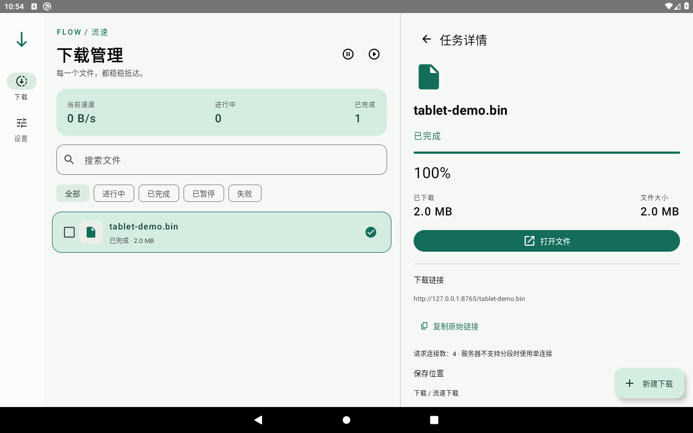

# 流速下载 · Flow Download

适用于 Android 10+ 手机和平板的原生 HTTP/HTTPS 下载器。Kotlin + Jetpack Compose，简洁界面、本地任务记录，无账号、广告或分析 SDK。

## 界面预览



## 使用

1. 从 [v0.1.0 预发布版本](https://github.com/Jimmy-xuzimo/flow-download/releases/tag/v0.1.0) 下载 APK，安装后打开“流速下载”。这是调试签名测试版本。
2. 点击“新建下载”，粘贴一个直链或每行一个链接；也可以从其他应用分享链接到流速下载。
3. 可填写文件名、选择保存目录，在高级设置中修改连接数和请求头。
4. 默认允许移动网络；设置中可以开启“仅在 Wi-Fi 下下载”、设置并发任务和全局限速。

默认保存到系统的 `Download/流速下载`。自选目录通过 Android 系统目录选择器授权，无需“所有文件访问”权限。同名文件另存，不覆盖。勾选任务可批量暂停、继续或取消；详情页可移除记录，删除已下载文件需单独勾选确认。

服务器支持 Range 时使用多连接下载，并校验响应区间。没有分段能力或没有可用文件校验标识的任务，恢复时会安全地从头开始。认证直链可以在高级设置中填写 `Authorization`、`Cookie`、`Referer` 等请求头；这些值使用 Android Keystore 加密存储，不记录到日志。跨站重定向会去除自定义请求头。

## 构建

需要 JDK 21、Android SDK Platform 36、Build Tools 36.0.0。使用 Android Studio 打开项目，或配置 `ANDROID_HOME`：

```sh
./gradlew :core:test :app:assembleDebug :app:lintDebug
```

APK 位于 `app/build/outputs/apk/debug/app-debug.apk`。项目包含 Gradle 8.13 Wrapper，首次构建需访问 Google Maven、Maven Central 和 Gradle 官方分发地址。不要把本机代理或 SDK 路径提交到源码；`local.properties`、本地 SDK、构建缓存均已忽略。

设备测试：

```sh
./gradlew :app:connectedDebugAndroidTest
```

测试覆盖输入校验、分享入口，以及通过本机 HTTP 测试服务下载、暂停、恢复、导出、SHA-256 对比和移除记录后保留文件。测试在设备上创建并清理测试文件；测试设备应避免存放需保留的本应用任务。

## 项目结构

- `core`：独立 JVM HTTP 引擎、分段计划、取消处理、全局限速器和协议测试。
- `app`：Room 任务存储、串行任务调度、前台服务、网络监听、MediaStore/系统目录导出、Keystore 和 Compose 自适应界面。
- `scripts/test_server.py`：用于实机测试的可控 HTTP 服务。
- `docs/TESTING.md`：本次实际验证记录、已知限制与设备验收步骤。

任务操作经过同一命令队列。暂停或删除会先取消并等待文件写入结束；数据库记录分段元数据，恢复偏移以实际临时文件长度为准。临时分段合并后再导出，导出失败保留完整临时文件，修正保存目录后可直接重试保存。

## 行为与限制

- 首版只支持普通 HTTP/HTTPS 文件，不包含 BT、磁力、M3U8、网页嗅探或内置浏览器。
- 默认 3 个并发任务、每任务 4 个连接；分别可设为 1–5 与 1–16。限速覆盖全部任务和连接，0 表示不限速。
- 临时分段、合并文件和导出文件会占用额外空间；最高可能接近原文件大小的三倍。
- 网络中断后等待连接恢复；临时服务器或连接错误最多自动重试 3 次，间隔 2、4、8 秒。认证错误与文件变化需用户处理。
- 已变化的远端文件必须确认重新下载，防止混合新旧内容。没有服务端 SHA-256 时，运行时只能校验分段范围、可用的版本标识及长度；不声称能发现服务端本身提供的损坏数据。
- 应用进程退出后保留任务；重新打开应用恢复调度。系统强行停止、后台限制和 Android 前台服务时限不能绕过。达到服务时限后暂停并提示重新打开应用。
- Android 13+ 通知权限不影响界面下载，但关闭权限后通知栏操作不可见。
- 大屏按当前窗口宽度切换：达到 840dp 使用双栏；较窄分屏仍使用单栏。
- 正式发布需要独立 release 签名和商店材料；此项目不包含发布密钥。

隐私：不上传下载历史、请求头或设备标识；应用数据禁用系统备份。HTTP 明文链接按用户输入执行；HTTPS 使用系统证书验证，不接受不可信证书。

## 验证状态

28 项核心测试、Android 10 手机与平板共 6 项设备测试通过，Android lint 为零错误。Android 16 的软件模拟器出现系统级启动超时，运行兼容性仍待真机或硬件加速模拟器补验。详见 [测试记录](docs/TESTING.md)。

## GitHub 测试版构建

仓库提供手动触发的 `Publish test APK` 工作流，从 `v0.1.0` 标签源码重新构建、运行核心测试和 lint，并上传 APK 与 SHA-256 校验文件到预发布版本。该流程不提交或保存签名密钥。GitHub 构建会生成新的调试签名，与此前本地测试 APK 不同；正式发布应配置固定签名。
